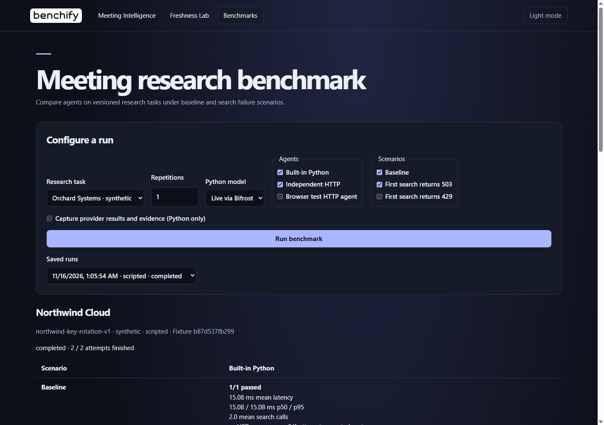

# Benchify

Don't just deploy AI agents. Prove they work.

Benchify is an early, single-operator AI agent quality engineering platform. Run repeatable benchmarks across the built-in Python agent and registered HTTP agents, exercise search failures, and inspect attempt traces. Neon stores queued runs and completed checkpoints. Meeting research is a reference workload. Tavily retrieves evidence, Bifrost handles structured model calls, and Benchify validates citations before displaying results.

Use the current release in a trusted environment. Opt in to capture and offline replay for Python benchmarks, then compare saved runs or inspect dated evidence. Tenant isolation is planned. See the [product roadmap](docs/PRODUCT_ROADMAP.md) and [security boundary](docs/SECURITY.md).



*Local Chrome acceptance run using the synthetic Northwind dataset and scripted responses.*

## Local setup

Install Python 3.11+ and Node.js 20.9+. Start a Bifrost gateway with a provider and a model that supports JSON-mode Chat Completions. Copy .env.example to .env. Set BIFROST_MODEL to your configured model, BIFROST_VIRTUAL_KEY if required, and TAVILY_API_KEY. Keep both services on loopback for local development. The example opts into the bundled loopback agent with BENCHIFY_ENV=development and BENCHIFY_ALLOW_LOCAL_AGENTS=1.

From the workspace root in PowerShell:

```powershell
python -m venv .venv
.venv\Scripts\python.exe -m pip install -r backend/requirements.txt
.venv\Scripts\python.exe -m uvicorn --app-dir backend benchify.main:app --host 127.0.0.1 --port 8000
```

In a second terminal:

```powershell
npm.cmd --prefix frontend install
npm.cmd --prefix frontend run dev -- --hostname 127.0.0.1
```

For the production frontend, build it once and start it on loopback. If FastAPI listens at a different origin, set `BENCHIFY_API_URL` in the same terminal before starting Next.js.

```powershell
npm.cmd --prefix frontend ci
npm.cmd --prefix frontend run build
npm.cmd --prefix frontend run start -- --hostname 127.0.0.1
```

Open http://localhost:3000. Use Meeting Intelligence to research a subject before a meeting. Open claim verification and provider activity to inspect the evidence and executed calls. Freshness Lab takes pasted text and evaluates up to four atomic claims. Review provider logs using the workflow correlation identifier. Browser print produces a clean briefing view.

## Verification and milestones

Run the mocked provider contract and workflow tests from the repository root:

```powershell
$env:PYTHONPATH = "backend"
.venv\Scripts\python.exe -m unittest discover -s backend/tests -v
npm.cmd --prefix frontend run build
```

For the credentialed smoke, generate a briefing for a company with recent announcements and paste a dated claim about that same company into Freshness Lab. Check each quoted excerpt against its source, and compare provider activity against Bifrost logs. No sample response is served as live evidence.

## Meeting research benchmark

Set `DATABASE_URL` in the root `.env` to a TLS-enabled Neon PostgreSQL connection string. The database role needs permission to create tables in its default schema. Start FastAPI with one process as shown above, then start the independent Node agent in another terminal.

```powershell
node --env-file=.env backend/http-agent.mjs
```

Open **Benchmarks** in the UI, select the Orchard Systems or Northwind Cloud task, and choose one to five repetitions. The task catalog identifies both as synthetic, versioned research datasets. Each repetition runs the selected agents and scenarios against the same task revision. The API queues the run in Neon and returns its ID. The API process runs one queued attempt at a time and saves each result and trace in a single transaction. Reopen runs in **Saved runs** to follow progress after a refresh. After an interruption the worker resumes from the first unfinished attempt once its lease expires, up to two minutes after it was claimed. An interrupted attempt can call a provider again. The fixture callbacks are scoped to an active attempt in the local API process.

The CLI can run the same benchmark against the running API. Add `--persist` to queue the run in Neon and wait for the saved result. Without that flag, the API returns the run and trace without requiring a database.

```powershell
$env:PYTHONPATH = "backend"
.venv\Scripts\python.exe -m benchify.benchmark_cli --repetitions 3
```

The UI defaults to live Bifrost calls for Python, which can incur provider charges. Select **Scripted test** for deterministic model responses. The independent Node service uses its own rules to extract the dated finding from the primary fixture excerpt. Select either or both agents and choose baseline, first-search HTTP 503, or first-search HTTP 429. The CLI accepts `--model-mode live` or `--model-mode scripted`; API requests that omit the mode use `BENCHIFY_BENCHMARK_MODEL`. Download a saved run as JSON to retain its configuration, results and traces together.

Additional HTTP agents can be registered by the operator in the root `.env`. Each entry needs a stable ID and revision. Change the revision when its behavior or endpoint changes.

```dotenv
BENCHIFY_HTTP_AGENTS='{"research-agent":{"name":"Research agent","revision":"v1","endpoint":"https://agent.example/execute","bearer_env":"BENCHIFY_AGENT_RESEARCH_TOKEN"}}'
BENCHIFY_AGENT_RESEARCH_TOKEN=
```

Restart FastAPI to load the registry. The UI and API list the IDs, names and revisions. The HTTP adapter sends `meeting`, `window`, and `search_url` as JSON. The agent must use the supplied fixture callback and return `findings` and `questions` in the shape shown in `backend/http-agent.mjs`. An agent outside loopback needs an execution endpoint whose exact HTTPS origin appears in BENCHIFY_AGENT_ALLOWED_ORIGINS. Its network must reach the fixture callback origin. To evaluate a search failure scenario, the agent must reach the injected fault and then successfully retrieve and cite evidence. **Repeat run** submits a new run against the original fixture, agent revisions, rubric and model mode when those revisions are available.

Run the integration smoke test with `.venv\Scripts\python.exe backend/tests/smoke_release.py`. It starts temporary loopback services and saves test runs to the configured database. Add `--restart` to restart the API after a checkpoint. Add `--live` to also exercise Tavily and Bifrost with configured credentials. Add `--web` after the production frontend build to check the web server and its benchmark API proxy.

To add research tasks, set `BENCHIFY_FIXTURE_DIRECTORY` in the root `.env` and place versioned JSON files in that directory. Follow the shape of `backend/benchify/meeting-fixture-northwind.json`. Use `"kind": "recorded"` for captured evidence and `"kind": "synthetic"` for generated cases. Each task needs a 30-day meeting window and one dated primary-source excerpt matching its canonical finding. Preserve the original task file when publishing a new revision so saved runs can be repeated.

The rubric requires the canonical event date, an exact primary-source excerpt, and a meeting question. It accepts the canonical finding text or a Python paraphrase that passed the excerpt-only entailment check and identifies the exact canonical text as its original span. Latency covers the full attempt, including the HTTP round trip for the Node agent. Tool calls count fixture search requests, including the failed call. Model calls appear separately in the trace. Usage totals sum values supplied by agents and providers. Scripted and rule-based calls use zero model tokens. Missing telemetry is recorded as null. USD cost is populated when a provider response includes numeric `usage.cost_usd`. Bifrost request IDs, when present, can be used to inspect gateway logs.

For live briefings, set `BENCHIFY_PRIMARY_DOMAINS` to a comma-separated list of trusted official source hostnames. Benchify gives matching sources priority. A supported development needs an exact excerpt with the event date and an excerpt-only model check that the text entails both the claim and the date.

See the [architecture](docs/ARCHITECTURE.md), [reliability and diagnosis guide](docs/RELIABILITY.md), [developer guide](docs/DEVELOPER_GUIDE.md) and [reuse review](docs/reuse-review.md).


See [Evidence capture, replay and regression comparison](docs/REPLAY_AND_REGRESSION.md) for the offline workflow and retention settings.

## Evidence and safe deployment

Select **Capture provider results and evidence** with only the built-in Python agent selected, or add **--capture** to the benchmark CLI. Open the completed run to inspect or download the recording, run **Replay offline and compare**, or select a second saved run to compare and export. See the [replay and API guide](docs/REPLAY_AND_REGRESSION.md) for local file replay and dated evidence history.

Private deployments require the same operator token in the web and backend environments, TLS at ingress, and explicit network policy. The current release has one operator boundary and shared data. It is intended for trusted development and private use. See [security](docs/SECURITY.md), [deployment and recovery](docs/DEPLOYMENT.md), and [brand assets](docs/BRAND.md).

## Hosted deployment status

The original Vercel URL returned platform HTTP 404. The replacement sranswal/benchify-private project is configured for Next.js. Deployment awaits the approved backend, staging secrets, and an end-to-end hosted check. The [private deployment guide](docs/DEPLOYMENT.md) specifies the Vercel frontend root, the always-on backend, staging secrets, browser acceptance and isolated database recovery. Hosted acceptance and managed Neon recovery remain release gates.
