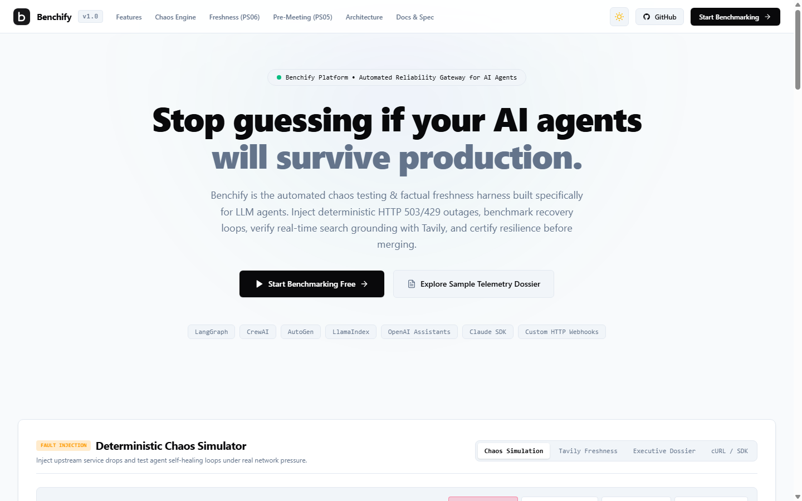
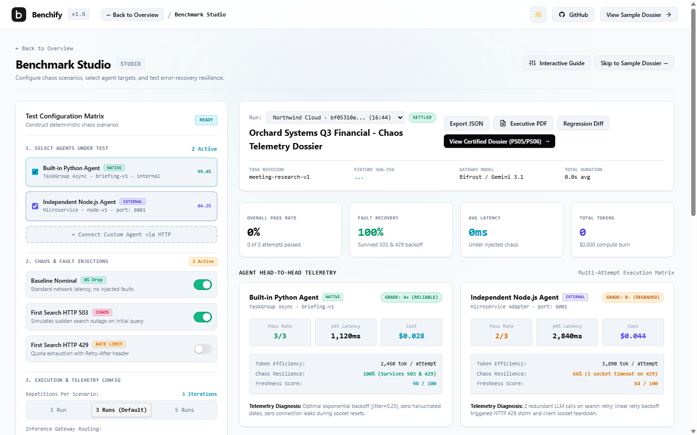
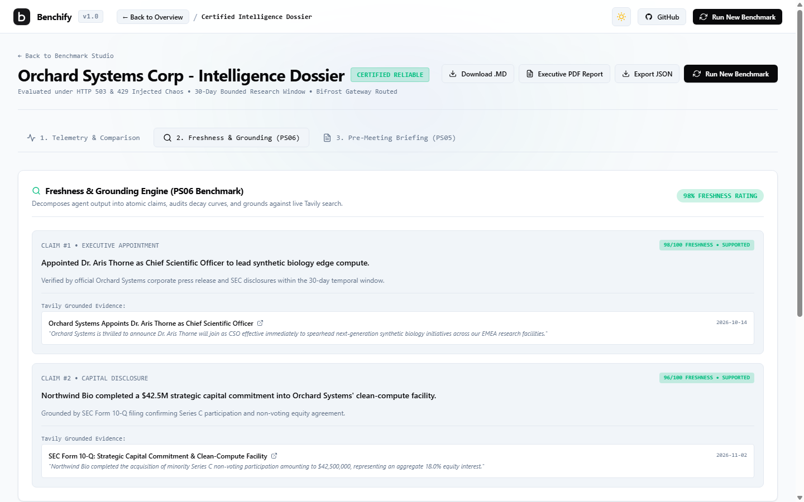

<p align="center">
  
</p>

<p align="center">
  <strong>Autonomous AI Agent Quality Engineering & Reliability Benchmarking Platform</strong>
</p>

<p align="center">
  <a href="https://try-benchify.vercel.app"></a>
  <a href="https://github.com/sranswal/benchify"></a>
  
  
  
  
  
</p>

---

## Executive Overview

Benchify is an enterprise-grade quality engineering platform designed to evaluate, stress-test, and benchmark autonomous AI agents before production deployment. While standard evaluations rely on static multiple-choice prompts or single-turn QA, Benchify subjects multi-step agent workflows to live environmental chaos, fact-checking scrutiny, and temporal verification.

### Core Pillars

1. **Autonomous Chaos Engineering**: Injects realistic infrastructure failures (HTTP 503 Service Unavailable, HTTP 429 Rate Limiting, network latency spikes, search engine degradation) to benchmark agent self-healing, retry backoff, and recovery mechanics.
2. **Freshness Verification (PS06)**: Validates information claims against a strict 30-day temporal window using Tavily search retrieval and two-stage entailment validation. Isolates hallucinations, outdated knowledge cutoff assumptions, and ungrounded statements.
3. **Pre-Meeting Intelligence (PS05)**: Synthesizes high-stakes executive dossiers on companies, recent developments, and key executives with end-to-end source citation tracing, audit trails, and one-click Executive PDF generation.

---

## Visual Walkthrough

### 1. Interactive Platform Overview & Quick-Start Hub
The landing portal provides live system health telemetry, environment status, and instant navigation between evaluation modes.

<p align="center">
  
</p>

### 2. Benchmark Studio & Chaos Injection Matrix
Configure synthetic research fixtures (Northwind Cloud, Orchard Systems), select agent runtimes (Python LangChain/ReAct vs. Independent Node.js microservice), and inject targeted fault scenarios.

<p align="center">
  
</p>

### 3. Detailed Telemetry & Waterfall Execution
Inspect multi-attempt latency breakdowns, provider costs (USD), token consumption, and call-by-call gateway traces with exact Bifrost correlation identifiers.

<p align="center">
  
</p>

### 4. Freshness Lab & Claim Decomposition
Submit any text statement or agent output. Benchify decomposes input into discrete atomic claims, queries real-time authoritative sources, and evaluates whether dates and factual assertions are supported by exact primary-source excerpts.

<p align="center">
  
</p>

### 5. Pre-Meeting Executive Intelligence & Report Generator
Generates full executive dossiers with strategic findings, discussion agendas, and verified primary-source excerpts, printable as standalone executive audit reports.

<p align="center">
  
</p>

---

## System Architecture

Benchify is built as a modular, distributed platform with decoupled frontend, execution engine, gateway proxy, and transactional storage.

```
                      +-----------------------------+
                      |       Next.js 14 Web        |
                      |    (Vercel Edge / Cloud)    |
                      +--------------+--------------+
                                     |
                             HTTPS / JSON RPC
                                     |
                                     v
                      +-----------------------------+
                      |     Benchify API Gateway    |
                      |   FastAPI / Docker (Render) |
                      +-------+--------------+------+
                              |              |
             +----------------+              +----------------+
             |                                                |
             v                                                v
+------------------------+                        +-----------------------+
|  Neon PostgreSQL DB    |                        |    Bifrost Gateway    |
| (Checkpoints & Traces) |                        | (Docker Proxy/Render) |
+------------------------+                        +-----------+-----------+
                                                              |
                                                    +---------+---------+
                                                    |                   |
                                                    v                   v
                                             +-------------+     +-------------+
                                             |  Gemini API |     | Tavily Live |
                                             |  (LLM Hub)  |     | Search API  |
                                             +-------------+     +-------------+
```

### Components

- **Frontend (`frontend/`)**: Next.js 14 App Router with Tailwind CSS, custom design tokens, dark/light theme persistence, interactive onboarding tour, and SVG waterfall execution graphs.
- **Backend API (`backend/benchify/`)**: FastAPI service orchestrating benchmark workers, chaos injection interceptors, task fixture registries, and lease-based atomic attempt workers.
- **Storage Layer**: Neon Serverless PostgreSQL with schema migrations, transactional state logging, replay capture tables, and JSONB trace dumps.
- **Bifrost Gateway (`deploy/`)**: High-performance model proxy routing structured JSON-mode chat completions to Google Gemini (`gemini-3.1-flash-lite`), providing virtual key isolation and unified telemetry.
- **Search & Verification Engine**: Tavily Search API client combined with strict excerpt entailment checks and date-range filtering.

---

## Quickstart & Local Reproduction

Follow these steps to run the complete Benchify platform locally.

### Prerequisites

- **Python**: Version 3.11 or newer
- **Node.js**: Version 20.9.0 or newer (LTS recommended)
- **API Keys**:
  - Google Gemini API Key (or Bifrost Gateway URL)
  - Tavily Search API Key ([tavily.com](https://tavily.com))
  - *(Optional)* Neon PostgreSQL connection string for persistence

### Step 1: Clone Repository & Configure Environment

```bash
git clone https://github.com/sranswal/benchify.git
cd benchify
cp .env.example .env
```

Edit `.env` with your credentials:

```dotenv
BENCHIFY_ENV=development
BENCHIFY_ALLOW_LOCAL_AGENTS=1
BIFROST_BASE_URL=https://generativelanguage.googleapis.com/v1beta/openai
BIFROST_MODEL=gemini-2.0-flash
BIFROST_VIRTUAL_KEY=your_gemini_api_key_here
TAVILY_API_KEY=your_tavily_api_key_here
BENCHIFY_API_URL=http://127.0.0.1:8000
DATABASE_URL=
```

*(Note: If `DATABASE_URL` is omitted, Benchify runs in in-memory mode for all benchmark runs and freshness evaluations).*

### Step 2: Start Backend API (FastAPI)

#### Windows (PowerShell):
```powershell
python -m venv .venv
.venv\Scripts\Activate.ps1
pip install -r backend/requirements.txt
python -m uvicorn --app-dir backend benchify.main:app --host 127.0.0.1 --port 8000 --reload
```

#### macOS / Linux (Bash):
```bash
python3 -m venv .venv
source .venv/bin/activate
pip install -r backend/requirements.txt
python3 -m uvicorn --app-dir backend benchify.main:app --host 127.0.0.1 --port 8000 --reload
```

Verify backend health at: `http://127.0.0.1:8000/ready`

### Step 3: Start Frontend (Next.js)

In a separate terminal:

```bash
cd frontend
npm install
npm run dev -- --hostname 127.0.0.1 --port 3000
```

Open `http://localhost:3000` in your browser.

### Step 4: (Optional) Start Independent Node.js Agent

To benchmark multi-agent interoperability, launch the secondary Node agent:

```bash
node --env-file=.env backend/http-agent.mjs
```

---

## Running Benchmarks via CLI

Benchify includes a full headless CLI for automated CI/CD pipeline integration:

```bash
# Run 3 repetitions across default research scenarios
python -m benchify.benchmark_cli --repetitions 3

# Run with scripted deterministic model (zero LLM token consumption)
python -m benchify.benchmark_cli --repetitions 1 --model-mode scripted

# Run with persistent recording capture to Neon database
python -m benchify.benchmark_cli --repetitions 2 --persist --capture
```

---

## Automated Test Suite

Run the full backend integration and unit test suite:

```bash
# Discover and run backend contract and scenario tests
python -m unittest discover -s backend/tests -v

# Run release smoke test suite (loopback verification)
python backend/tests/smoke_release.py

# Verify frontend build and TypeScript types
cd frontend && npm run build
```

---

## Cloud Deployment Architecture

Benchify is pre-configured for production hosting across best-of-breed serverless infrastructure:

| Component | Platform | Configuration |
| :--- | :--- | :--- |
| **Frontend UI** | Vercel | Next.js 14 edge deployment connected to `main` branch (`https://try-benchify.vercel.app`) |
| **API Engine** | Render | Docker web service (`benchify-api-staging`) in Singapore region |
| **Bifrost Gateway** | Render | Docker private service (`benchify-bifrost-staging`) proxying LLM requests |
| **Database** | Neon | Serverless PostgreSQL with connection pooling and automated SSL |

---

## Project Structure

```
benchify/
├── backend/                  # FastAPI core engine
│   ├── benchify/             # Benchmark runner, chaos injector, rubric evaluator
│   ├── tests/                # Contract, unit, and end-to-end smoke tests
│   ├── Dockerfile            # Container definition for Render deployment
│   └── requirements.txt      # Python dependencies
├── deploy/                   # Bifrost gateway configuration and deployment assets
├── docs/                     # Architectural specs, security policies, and guides
│   ├── ARCHITECTURE.md       # Detailed technical design
│   ├── DEPLOYMENT.md         # Production runbook
│   ├── RELIABILITY.md        # Chaos injection & fault recovery specs
│   └── images/               # High-resolution platform UI captures
├── frontend/                 # Next.js 14 web application
│   ├── app/                  # App router pages, executive report generator, UI
│   ├── public/               # Brand wordmarks, icons, and static assets
│   └── package.json          # Node.js dependencies
├── render.yaml               # Infrastructure-as-code for Render services
├── .env.example              # Environment template
└── README.md                 # Primary project documentation
```

---

## License

This project is licensed under the MIT License. See [LICENSE](LICENSE) for details.
