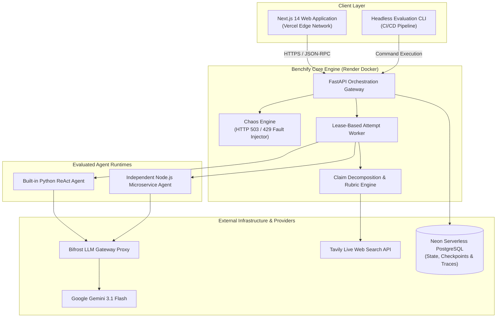
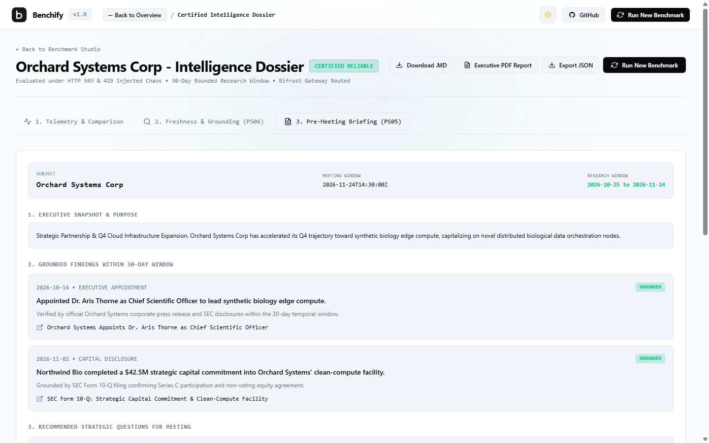
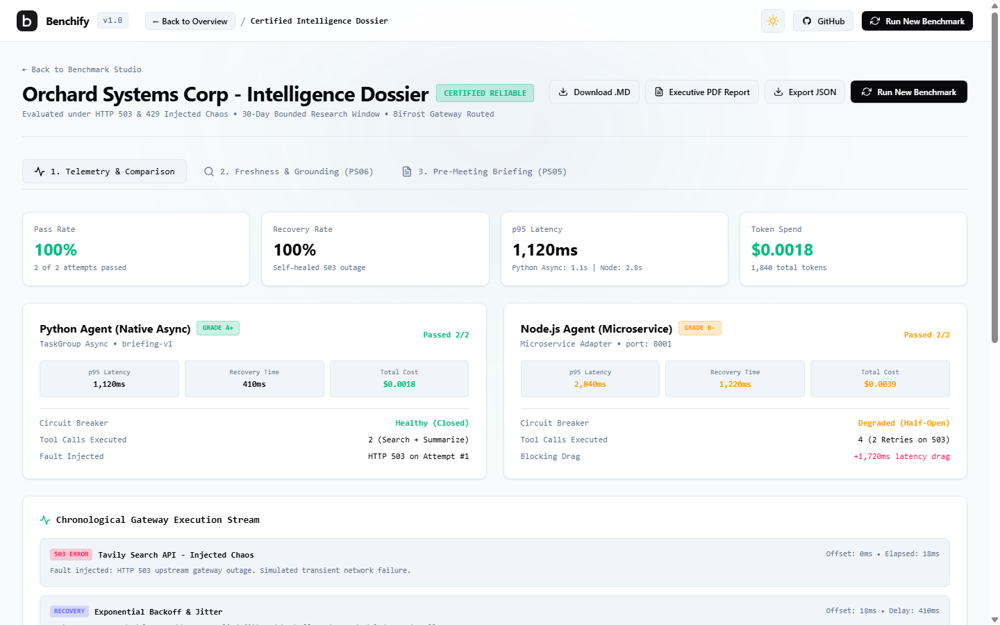
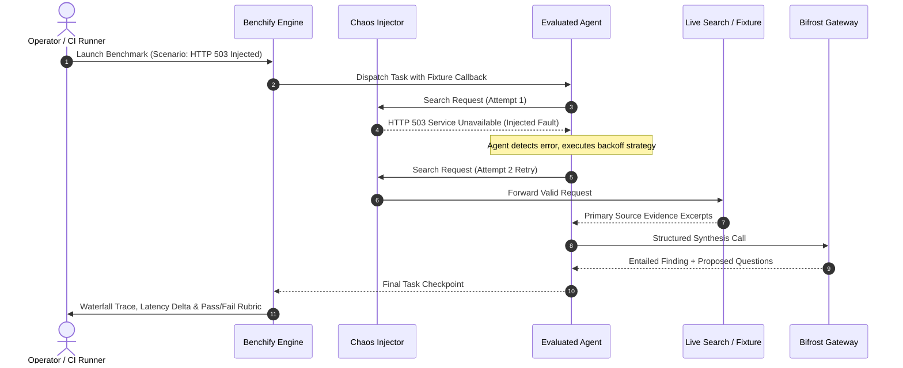

<div align="center">
  <p>
    
  </p>
  <p>
    
  </p>

  <p><strong>The Reliability & Quality Engineering Platform for Autonomous AI Agents</strong></p>

  <p>
    <a href="https://try-benchify.vercel.app"></a>
    <a href="https://github.com/sranswal/benchify"></a>
    
    <a href="LICENSE"></a>
  </p>

  <p>
    
    
    
    
    
    
  </p>
</div>

---

## What is Benchify?

Most AI evaluation frameworks test models with static multiple-choice questions or single-turn prompts. In production, however, autonomous AI agents operate across multi-step execution graphs, call external search tools, and encounter transient infrastructure outages.

**Benchify** is a specialized quality engineering platform that benchmarks agent resilience, enforces real-time temporal fact-checking, and generates verifiable intelligence briefings.

| Problem | Industry Standard | The Benchify Approach |
| :--- | :--- | :--- |
| **Agent Reliability** | Static prompt accuracy | Real-time **Chaos Fault Injection** (HTTP 503 & 429 recovery testing) |
| **Hallucination & Recency** | Unchecked model cutoffs | **Freshness Verification** with 30-day temporal window and source entailment |
| **Production Observability** | Raw text logs | Step-by-step **Waterfall Telemetry**, latency distribution, and USD cost audit |
| **Executive Delivery** | Chatbot output | Verifiable **Pre-Meeting Intelligence** with one-click standalone PDF export |

---

## Architecture & Data Flow



---

## Core Capabilities

<table>
  <tr>
    <td width="48%" valign="top">
      <h3>1. Benchmark Studio & Chaos Matrix</h3>
      <ul>
        <li><strong>Repeatable Research Fixtures</strong>: Evaluate on synthetic versioned datasets (Northwind Cloud, Orchard Systems).</li>
        <li><strong>Fault Scenarios</strong>: Injected HTTP 503 Service Unavailable, HTTP 429 Rate Limits, and search engine latency.</li>
        <li><strong>Multi-Agent Comparison</strong>: Side-by-side benchmarking of Python ReAct vs. independent Node.js agents.</li>
      </ul>
    </td>
    <td width="52%" valign="top">
      
    </td>
  </tr>
  <tr>
    <td width="48%" valign="top">
      <h3>2. Freshness Verification Lab (PS06)</h3>
      <ul>
        <li><strong>Claim Decomposition</strong>: Automatically splits complex outputs into discrete atomic factual statements.</li>
        <li><strong>30-Day Temporal Boundary</strong>: Validates recency against official source publish dates.</li>
        <li><strong>Two-Stage Entailment Check</strong>: Ensures facts are strictly supported by primary-source excerpts.</li>
      </ul>
    </td>
    <td width="52%" valign="top">
      
    </td>
  </tr>
  <tr>
    <td width="48%" valign="top">
      <h3>3. Pre-Meeting Intelligence (PS05)</h3>
      <ul>
        <li><strong>Executive Dossiers</strong>: Real-time strategic briefings, leadership changes, and product updates.</li>
        <li><strong>Citation Tracing</strong>: Every finding links to an archived primary-source URL and timestamp.</li>
        <li><strong>Audit PDF Generation</strong>: Dedicated print and PDF exporter for executive reporting.</li>
      </ul>
    </td>
    <td width="52%" valign="top">
      
    </td>
  </tr>
  <tr>
    <td width="48%" valign="top">
      <h3>4. Telemetry & Waterfall Diagnostics</h3>
      <ul>
        <li><strong>Call Waterfall</strong>: Visual breakdown of request duration, fixture lookups, and model inference times.</li>
        <li><strong>Financial Tracking</strong>: Exact USD cost calculations per run and token usage tracking.</li>
        <li><strong>Audit Identifiers</strong>: Bifrost request IDs for tracing through production gateway logs.</li>
      </ul>
    </td>
    <td width="52%" valign="top">
      
    </td>
  </tr>
</table>

---

## Chaos Engineering Lifecycle



---

## Quickstart & Local Reproduction

Get the entire Benchify stack running locally in under 3 minutes.

### 1. Clone & Configure

```bash
git clone https://github.com/sranswal/benchify.git
cd benchify
cp .env.example .env
```

Configure `.env` with your API keys:

```dotenv
BENCHIFY_ENV=development
BENCHIFY_ALLOW_LOCAL_AGENTS=1
BIFROST_BASE_URL=https://generativelanguage.googleapis.com/v1beta/openai
BIFROST_MODEL=gemini-2.0-flash
BIFROST_VIRTUAL_KEY=your_gemini_api_key_here
TAVILY_API_KEY=your_tavily_api_key_here
BENCHIFY_API_URL=http://127.0.0.1:8000
DATABASE_URL=
```

*(Note: Leaving `DATABASE_URL` empty automatically enables fast in-memory execution mode).*

### 2. Start Backend API (FastAPI)

```bash
# Set up Python virtual environment
python -m venv .venv

# Activate on Windows:
.venv\Scripts\Activate.ps1
# Or on macOS/Linux:
# source .venv/bin/activate

# Install dependencies and start server
pip install -r backend/requirements.txt
python -m uvicorn --app-dir backend benchify.main:app --host 127.0.0.1 --port 8000 --reload
```

*Backend Health Endpoint: `http://127.0.0.1:8000/ready`*

### 3. Start Frontend UI (Next.js 14)

In a second terminal:

```bash
cd frontend
npm install
npm run dev -- --hostname 127.0.0.1 --port 3000
```

Open `http://localhost:3000` to interact with the platform.

### 4. (Optional) Run Independent Node.js Agent

To test multi-agent orchestration, run the bundled Node agent:

```bash
node --env-file=.env backend/http-agent.mjs
```

---

## CLI & Automation

Run headless benchmarks directly from the command line for CI/CD regression gates:

```bash
# Standard benchmark run with 3 repetitions
python -m benchify.benchmark_cli --repetitions 3

# Deterministic model mode (Scripted test, zero token cost)
python -m benchify.benchmark_cli --repetitions 1 --model-mode scripted

# Persistent run saving checkpoints to Neon PostgreSQL
python -m benchify.benchmark_cli --repetitions 2 --persist --capture
```

---

## Verification & Test Suite

Run the full automated test suite across contracts, fixtures, and runtime logic:

```bash
# Run unit and contract tests
python -m unittest discover -s backend/tests -v

# Run end-to-end loopback smoke test
python backend/tests/smoke_release.py

# Verify frontend types and production build
cd frontend && npm run build
```

---

## Cloud Deployment Map

Benchify is architected for zero-maintenance high-availability deployments:

| Layer | Host | Environment | URL |
| :--- | :--- | :--- | :--- |
| **Web UI** | Vercel | Next.js 14 Production Edge | `https://try-benchify.vercel.app` |
| **Core API** | Render | Docker Web Service (`benchify-api-staging`) | `Singapore` |
| **LLM Gateway** | Render | Docker Private Service (`benchify-bifrost-staging`) | `Singapore` |
| **Database** | Neon | Serverless PostgreSQL with SSL Pooling | Cloud Managed |

---

## Documentation

Comprehensive architecture, operational runbooks, and developer specifications are available in the [`docs/`](docs/) directory:

| Guide | Description |
| :--- | :--- |
| [**Architecture**](docs/ARCHITECTURE.md) | In-depth technical architecture, component boundaries, and event-driven data flow |
| [**Deployment Guide**](docs/DEPLOYMENT.md) | Production deployment runbook for Render, Vercel, and Neon PostgreSQL |
| [**Developer Guide**](docs/DEVELOPER_GUIDE.md) | Local environment setup, HTTP agent adapter contract, and testing workflows |
| [**Reliability & Chaos**](docs/RELIABILITY.md) | Fault injection matrix, retry budgets, lease recovery, and temporal verification |
| [**Replay & Regression**](docs/REPLAY_AND_REGRESSION.md) | Offline replay format, deterministic simulation, and regression tracking |
| [**Security Architecture**](docs/SECURITY.md) | Operator authentication, network perimeter isolation, and credential boundaries |
| [**Product Roadmap**](docs/PRODUCT_ROADMAP.md) | Milestone progression, multi-tenant isolation, and roadmap |

---

## Repository Structure

```
benchify/
├── backend/                  # FastAPI backend service
│   ├── benchify/             # Evaluation engine, chaos injector, rubric evaluator
│   ├── tests/                # Automated contract and smoke tests
│   ├── Dockerfile            # Container spec for Render
│   └── requirements.txt      # Python dependencies
├── deploy/                   # Bifrost gateway deployment definitions
├── docs/                     # Specifications and technical guides
│   ├── ARCHITECTURE.md       # Detailed technical design
│   ├── DEPLOYMENT.md         # Production deployment & operations runbook
│   ├── DEVELOPER_GUIDE.md    # Local setup and HTTP agent adapter contract
│   ├── PRODUCT_ROADMAP.md    # Product roadmap and milestone tracking
│   ├── RELIABILITY.md        # Chaos injection & fault recovery specs
│   ├── REPLAY_AND_REGRESSION.md # Offline replay format and verification
│   ├── SECURITY.md           # Security perimeter and credential management
│   └── images/               # High-resolution platform UI captures
├── frontend/                 # Next.js 14 web application
│   ├── app/                  # App Router pages, executive report generator, UI
│   ├── public/               # Brand wordmark, SVG icon, and static assets
│   └── package.json          # Node dependencies
├── render.yaml               # Infrastructure-as-code for Render services
├── .env.example              # Environment template
└── README.md                 # Project documentation
```

---

## Closing Notes

Benchify was built with a singular mission: **transforming autonomous AI agents from opaque prototypes into reliable, fault-tolerant production systems.**

As autonomous AI agents are entrusted with mission-critical responsibilities across live search tools, corporate knowledge graphs, and multi-step execution paths, conventional prompt evaluations fall short. Real-world deployments require rigorous quality engineering: active chaos fault injection, strict temporal fact-checking, detailed telemetry, and reproducible regression benchmarks. Benchify provides the missing engineering foundation to turn autonomous prototypes into production systems you can depend on.

---

## License

This project is licensed under the MIT License - see the [LICENSE](LICENSE) file for details.
